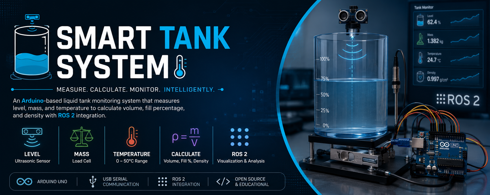

# 💧 Smart Tank System

### Arduino-Based Liquid Monitoring and ROS 2 Integration

<p align="center">
  
</p>

<p align="center">
  
  
  
  
  
</p>

<p align="center">
  An educational engineering project combining embedded systems, instrumentation, mechanical design, liquid property calculations, and robotics software.
</p>

---

## 📌 Overview

The **Smart Tank System** is an engineering project designed to monitor liquid level, mass, and temperature using an Arduino Uno and multiple sensors.

The system will acquire sensor measurements and use them to estimate parameters such as liquid volume, fill percentage, and density. Measurements will be transmitted to a computer over USB serial, where a ROS 2 application will process the data and provide a graphical user interface (GUI).

The project combines embedded C++ development, Python and C++ robotics software, sensor integration, engineering calculations, and mechanical CAD design using SolidWorks.

> 🚧 **Project status:** The project is under development. Initial documentation, electrical design, individual mechanical models, and the SolidWorks assembly have been completed. Hardware integration, firmware, sensor calibration, and ROS 2 functionality will be developed and validated progressively.

## 🎯 Objectives

- 📏 **Level Measurement** — Measure the distance between an ultrasonic sensor and the liquid surface.
- ⚖️ **Mass Measurement** — Measure the tank's mass using a load cell and an appropriate amplifier.
- 🌡️ **Temperature Monitoring** — Monitor liquid temperature within the intended operating range of 0–50°C.
- 🧮 **Volume Calculation** — Estimate liquid volume using the measured level and tank geometry.
- 🧪 **Density Estimation** — Estimate liquid density using mass and volume measurements.
- 🔌 **Serial Communication** — Transmit measurements from the Arduino to a computer over USB.
- 🤖 **ROS 2 Integration** — Develop nodes for receiving, processing, and distributing measurement data.
- 🖥️ **Graphical User Interface** — Display sensor readings, calculated parameters, and tank status.
- 🧩 **Mechanical CAD Design** — Model the cylindrical tank, sensor mounting arrangements, supporting brackets, and complete assembly in SolidWorks.
- 📊 **Testing and Validation** — Compare system measurements against reference measurements and document accuracy.

## 🏗️ System Architecture

The proposed system consists of a physical measurement system, an Arduino controller, and a computer running ROS 2.

```text
┌────────────────────────────────────────┐
│              LIQUID TANK               │
│                                        │
│  HC-SR04 Ultrasonic Sensor             │
│  Load Cell + HX711 Amplifier           │
│  DS18B20 Temperature Sensor            │
└───────────────────┬────────────────────┘
                    │ Sensor Signals
                    ▼
┌────────────────────────────────────────┐
│               ARDUINO UNO              │
│                                        │
│  Sensor Acquisition                    │
│  Initial Data Handling                 │
│  USB Serial Transmission               │
└───────────────────┬────────────────────┘
                    │ USB Serial
                    ▼
┌────────────────────────────────────────┐
│                 ROS 2 PC               │
│                                        │
│  Arduino Bridge Node                   │
│  Tank Processor Node                   │
│  Tank GUI Node                         │
│                                        │
│  Data Processing and Visualization     │
└────────────────────────────────────────┘
```

_This diagram represents the planned architecture. The final implementation may change during development._

## 🔧 Hardware

| Component                            | Purpose                                                                   |
| ------------------------------------ | ------------------------------------------------------------------------- |
| Arduino Uno                          | Main controller for sensor acquisition                                    |
| HC-SR04 ultrasonic sensor            | Liquid-level measurement                                                  |
| Load cell                            | Tank and liquid mass measurement                                          |
| HX711 amplifier                      | Interfaces the load cell with the Arduino                                 |
| Waterproof DS18B20 temperature probe | Liquid-temperature measurement                                            |
| Cylindrical tank                     | Contains the liquid being monitored                                       |
| Tank cover                           | Covers the tank and supports the ultrasonic sensor                        |
| Load-cell brackets                   | Support the tank and provide the intended load path through the load cell |
| USB cable                            | Connects the Arduino to the computer                                      |

The load-cell model and capacity, tank dimensions, and final hardware specifications will be documented as the design progresses.

For detailed component descriptions and proposed electrical connections, see:

- [Hardware Components](hardware/components.md)
- [Hardware Wiring Guide](hardware/wiring.md)

## 🧩 CAD Design and Mechanical Assembly

The mechanical design of the Smart Tank System has been modeled and assembled using **SolidWorks**.

The completed mechanical model includes the cylindrical tank, supporting structure, sensor mounting arrangements, and the mechanical components required for the proposed monitoring system.

### Mechanical Design

- **Cylindrical Tank** — The main structure that contains the liquid being monitored.
- **Load-Cell Brackets** — Located underneath the tank to support the assembly and accommodate the load-cell mounting arrangement.
- **Top Cover and Ultrasonic Sensor Mounting** — A cover fitted above the tank, with an opening to mount the HC-SR04 ultrasonic sensor facing the liquid surface.
- **Temperature Probe Opening** — A hole near the bottom of the tank's side wall for inserting the waterproof DS18B20 probe into the liquid.
- **Mechanical Assembly** — Combines the individual modeled components into one SolidWorks assembly.

### CAD Progress

- [x] Model individual mechanical components.
- [x] Create the cylindrical tank model.
- [x] Design the load-cell brackets.
- [x] Model the top cover and ultrasonic sensor mounting.
- [x] Add the temperature probe opening.
- [x] Complete the SolidWorks mechanical assembly.

### CAD Files and Visualization

The `cad/` directory contains the native SolidWorks files and visual representations of the mechanical design.

| Directory       | Contents                                            |
| --------------- | --------------------------------------------------- |
| `cad/parts/`    | Individual SolidWorks part files (`.SLDPRT`)        |
| `cad/assembly/` | Main assembly and subassemblies (`.SLDASM`)         |
| `cad/renders/`  | CAD screenshots and rendered views (`.png`, `.jpg`) |
| `cad/README.md` | CAD file organization and assembly documentation    |

The initial mechanical modeling and assembly objectives have been completed. The CAD model provides the mechanical representation of the proposed system and will serve as a reference during hardware integration.

## 💻 Software and Technologies

<p>
  
  
  
  
  
  
  
  
</p>

- **Embedded development:** C++ using the Arduino development environment.
- **Robotics software:** Python and C++ with ROS 2.
- **Microcontroller:** Arduino Uno.
- **Communication:** USB serial between the Arduino and the ROS 2 computer.
- **Graphical interface:** A planned GUI node for monitoring measurements and tank status.
- **Mechanical design:** SolidWorks part modeling and assembly.
- **Development environment:** Linux.
- **Version control:** Git and GitHub.

These technologies represent the planned development environment. Software components will be implemented and tested progressively.

## 🤖 ROS 2 Architecture

The ROS 2 application will consist of **three nodes**, each with a distinct responsibility.

### 1. Arduino Bridge Node

**Proposed file:** `arduino_bridge_node.py`

This node will provide the interface between the Arduino Uno and ROS 2.

Responsibilities:

- Establish USB serial communication with the Arduino.
- Receive sensor measurements transmitted by the Arduino firmware.
- Validate and parse incoming serial data.
- Publish sensor measurements to ROS 2 topics.
- Handle communication errors and unavailable serial connections.

### 2. Tank Processor Node

**Proposed file:** `tank_processor_node.py`

This node will process incoming sensor data and calculate the tank's engineering parameters.

Responsibilities:

- Subscribe to the sensor topics published by the Arduino bridge.
- Process distance, temperature, and mass measurements.
- Estimate liquid level and volume using the tank geometry.
- Calculate fill percentage and estimate density when valid measurements are available.
- Publish processed measurements and tank status.
- Handle invalid readings and avoid unreliable calculations when the measured volume is close to zero.

### 3. Tank GUI Node

**Proposed file:** `tank_gui_node.py`

This node will provide the graphical interface for the user.

Responsibilities:

- Display raw sensor measurements.
- Display calculated liquid level, volume, fill percentage, and density when available.
- Display liquid temperature and measured mass.
- Present the current tank status.
- Show warnings when measurements are invalid or sensor communication is unavailable.

The GUI will subscribe to raw sensor and processed-data topics so users can view original measurements alongside calculated results.

### Planned ROS 2 Topics

The following topic names are proposed for the initial implementation.

| Topic                         | Purpose                                 | Publisher      |
| ----------------------------- | --------------------------------------- | -------------- |
| `/tank/sensors/distance_m`    | Measured distance to the liquid surface | Arduino Bridge |
| `/tank/sensors/temperature_c` | Measured liquid temperature             | Arduino Bridge |
| `/tank/sensors/weight_kg`     | Calibrated measured mass                | Arduino Bridge |
| `/tank/level_m`               | Estimated liquid level                  | Tank Processor |
| `/tank/volume_l`              | Estimated liquid volume                 | Tank Processor |
| `/tank/fill_percentage`       | Estimated tank fill percentage          | Tank Processor |
| `/tank/density_kg_m3`         | Estimated liquid density                | Tank Processor |
| `/tank/status`                | Current tank status and warnings        | Tank Processor |

The final topic names, message types, units, and publication rates will be confirmed during implementation.

### Planned Node Communication

```text
Arduino Uno
    │
    │ USB Serial
    ▼
Arduino Bridge Node
    │
    ├── /tank/sensors/distance_m
    ├── /tank/sensors/temperature_c
    └── /tank/sensors/weight_kg
                │
                ▼
        Tank Processor Node
                │
                ├── /tank/level_m
                ├── /tank/volume_l
                ├── /tank/fill_percentage
                ├── /tank/density_kg_m3
                └── /tank/status
                         │
                         ▼
                    Tank GUI Node
                         │
                         ▼
                    User Interface
```

The GUI node will also subscribe directly to raw sensor topics to display original measurements. A ROS 2 launch file will be developed to start the three nodes together.

## 📐 Engineering Calculations

The system will derive additional parameters from calibrated sensor readings.

### 1. Liquid Level

The liquid level will be estimated from the sensor's reference height and its measured distance to the liquid surface.

$$
h = H - d
$$

Where:

- \(h\) = liquid level
- \(H\) = reference height from the sensor to the tank-bottom datum
- \(d\) = measured distance from the sensor to the liquid surface

The reference height and sensor position must be defined consistently during installation.

### 2. Liquid Volume

For a cylindrical tank with a constant internal cross-sectional area:

$$
V_{\text{liquid}} = A \times h
$$

For a cylindrical tank with internal radius \(r\):

$$
A = \pi r^2
$$

Therefore:

$$
V_{\text{liquid}} = \pi r^2 h
$$

Where:

- \(V\_{\text{liquid}}\) = liquid volume
- \(A\) = internal horizontal cross-sectional area
- \(r\) = internal tank radius
- \(h\) = liquid level

The model assumes a vertical cylindrical tank with a flat bottom and a consistent internal cross-section. Actual tank geometry will be considered during implementation.

### 3. Fill Percentage

$$
\text{Fill Percentage} =
\frac{V_{\text{liquid}}}{V_{\text{tank}}}
\times 100\%
$$

Where \(V\_{\text{tank}}\) is the usable tank capacity.

### 4. Liquid Mass

The liquid mass will be determined from the calibrated load-cell measurement with appropriate tare compensation.

$$
m_{\text{liquid}} =
m_{\text{measured}} - m_{\text{empty tank}}
$$

This expression assumes the measured load includes the empty tank's mass. The final calculation will depend on the mechanical arrangement and tare procedure.

### 5. Liquid Density

$$
\rho =
\frac{m_{\text{liquid}}}{V_{\text{liquid}}}
$$

Where:

- \(\rho\) = estimated liquid density
- \(m\_{\text{liquid}}\) = liquid mass
- \(V\_{\text{liquid}}\) = liquid volume

Density estimation requires valid mass and volume measurements. Results may be unreliable when the measured volume is close to zero.

All calculations will account for tank geometry, sensor placement, calibration, measurement uncertainty, and valid measurement ranges.

For the detailed equations, variables, units, and planned verification procedures, see [Engineering Calculations](hardware/calculations.md).

## 📚 Documentation

### Hardware Documentation

- [Hardware Components](hardware/components.md) — Component descriptions, responsibilities, and engineering considerations.
- [Hardware Wiring Guide](hardware/wiring.md) — Proposed Arduino pin assignments, sensor connections, load-cell wiring, and power distribution.
- [Engineering Calculations](docs/calculations.md) — Equations and methods for calculating liquid level, volume, fill percentage, mass, and density.

### Project Documents

- 📄 [Project Proposal](<docs/Team 3_Project proposal.pdf>) — Project motivation, objectives, scope, and methodology.
- 📚 [Literature Review](<docs/Team 3_Literature review.pdf>) — Background research and review of existing approaches.
- 🔌 [Circuit Design](<docs/Team 3_Circuit design.pdf>) — Proposed electrical circuit and sensor connections.
- 🔄 [Project Flowchart](<docs/Team 3_Project flowchart.pdf>) — Planned system workflow and processing sequence.
- 🤖 [ROS 2 Nodes and Topics](<docs/Team 3_Nodes&Topics.pdf>) — Proposed node responsibilities and communication topics.

## 🛠️ Development Roadmap

### Project Planning and Design

- [x] Define the initial project scope.
- [x] Prepare the project proposal.
- [x] Prepare the literature review.
- [x] Document the initial hardware components.
- [x] Prepare the proposed hardware wiring guide.
- [x] Document the engineering calculations.
- [x] Complete individual SolidWorks mechanical parts.
- [x] Complete the SolidWorks mechanical assembly.

### Hardware and Embedded Systems

- [ ] Finalize physical hardware connections.
- [ ] Implement Arduino sensor acquisition in C++.
- [ ] Calibrate and validate individual sensors.
- [ ] Implement USB serial communication.

### ROS 2 Development

- [ ] Develop the Arduino bridge node.
- [ ] Develop the tank processor node.
- [ ] Develop the tank GUI node.
- [ ] Define and validate ROS 2 topics and message types.
- [ ] Create a launch file for the three ROS 2 nodes.
- [ ] Test communication between the Arduino and ROS 2.

### System Testing and Validation

- [ ] Validate engineering calculations against reference measurements.
- [ ] Conduct system-level testing.
- [ ] Document experimental results and measurement accuracy.

## 📊 Testing and Validation

Testing will focus on:

- Sensor calibration and repeatability.
- Liquid-level and volume-estimation accuracy.
- Load-cell accuracy and tare compensation.
- Temperature-measurement accuracy.
- USB serial communication reliability.
- ROS 2 topic publication and subscription.
- Data exchange between all three nodes.
- GUI display accuracy and status updates.
- Comparison of calculated values against reference measurements.
- Mechanical fit and alignment of the CAD assembly.
- Overall system performance under different operating conditions.

Experimental results and measured accuracy will be documented after testing begins.

## 🔮 Future Improvements

Potential extensions include:

- Live ROS 2 dashboards and enhanced data visualization.
- Data logging and historical analysis.
- Measurement filtering and noise reduction.
- Support for different tank geometries.
- Improved calibration and uncertainty analysis.
- Sensor diagnostics and communication monitoring.
- Additional tank status indicators and configurable warnings.
- Further mechanical refinements based on prototype testing.

## 👨‍💻 Author

**Mohamed Samer**  
Mechatronics Engineering Student

Interested in embedded systems, robotics, automation, mechanical design, and engineering simulation.

---

<p align="center">
  <i>Developed as an educational engineering project exploring embedded systems, instrumentation, mechanical design, and robotics.</i>
</p>
